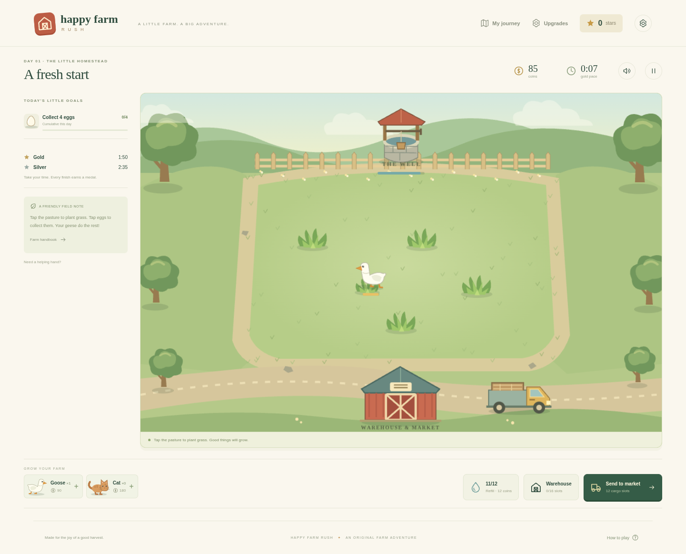
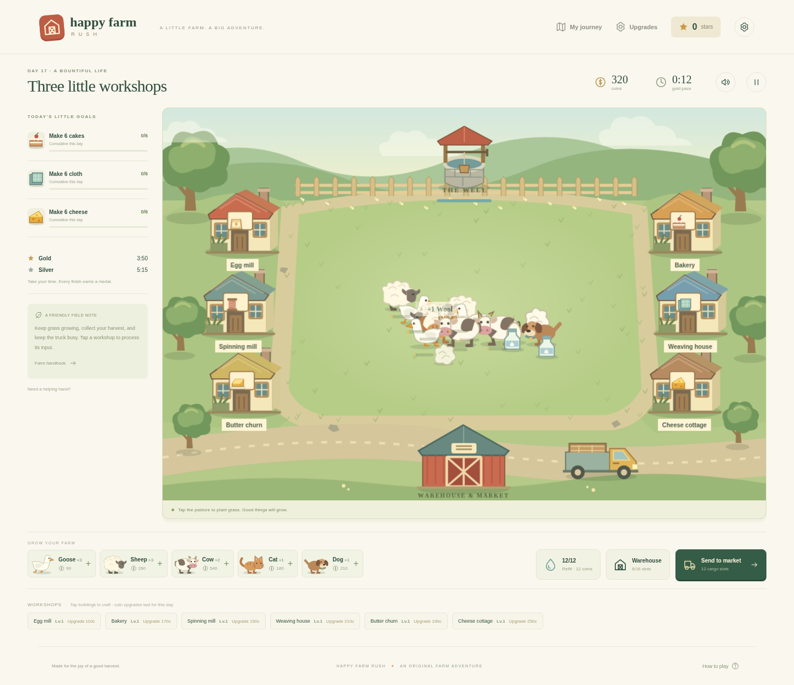
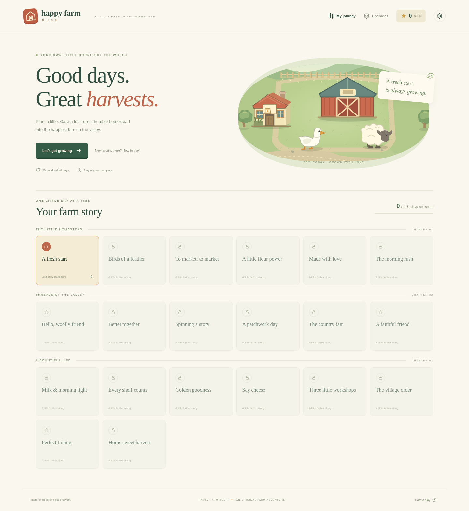
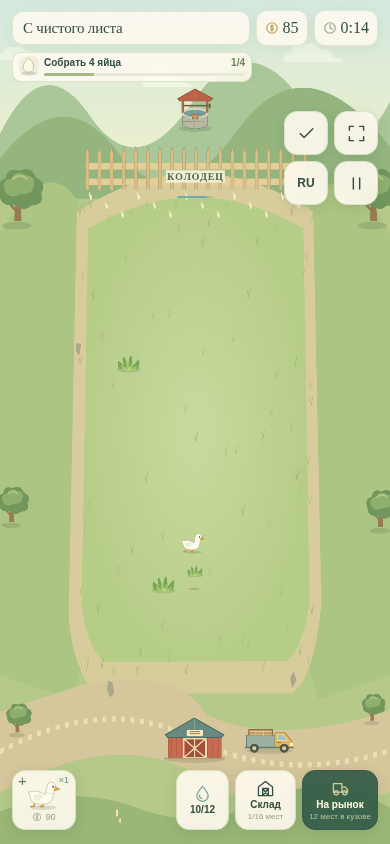
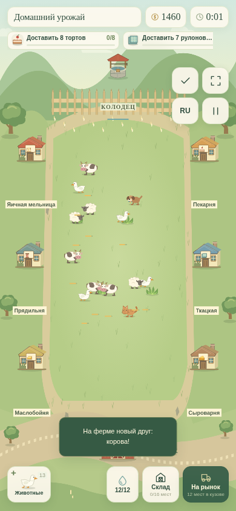

# Happy Farm Rush

An original, self-contained 2D farm time-management game inspired by the gameplay of classic Farm Frenzy. Twenty individual days take a small goose pasture through three production chains, market deliveries, bears, and a persistent campaign. No accounts, server, ads, paid services, or runtime network dependencies.

## Play locally

Requires Node.js 22.12+ (tested with Node 24) and npm.

```sh
npm install
npm run dev
```

Open the address Vite prints. Tap empty pasture to grow grass, products to collect, a workshop to process, and the warehouse to select a shipment. Tap bears repeatedly to cage them, then tap the cage to collect it. Space / Escape pauses. Use the in-game handbook for the complete rules.

```sh
npm test                 # deterministic simulation and persistence tests
npm run build            # strict TypeScript check and static production build
npm run preview          # preview dist/
npm run balance          # 100 deterministic campaign/profile simulations
npm run test:e2e         # desktop, phone landscape, phone portrait
```

Browser tests default to a running Vite server on port 5173. To test the production build instead, run `npm run preview -- --port 5174`, then `PLAYWRIGHT_BASE_URL=http://127.0.0.1:5174 npm run test:e2e`. They use `/usr/bin/chromium` by default. Set `CHROMIUM_PATH` to your local Chrome/Chromium executable, or install Chromium via `npx playwright install chromium` and set its executable path. Screenshots are written to `screenshots/`. Browser tests use `?renderer=canvas` for reproducible headless rendering; normal play uses Phaser's automatic renderer selection (WebGL when available). Both render the same authoritative simulation.

## Deployment

Published on Cloudflare Workers: **https://pg-happy-farm-rush.register-c02.workers.dev/**

`wrangler.jsonc` serves the Vite build (`dist/`) as static assets from the Worker `pg-happy-farm-rush`. Cloudflare Workers Builds runs `npm test && npm run build` and then `npx wrangler@4 deploy` on every push to `main`; if the tests or the build fail, nothing is deployed. `.github/workflows/ci.yml` runs the same checks on GitHub (it does not publish). GitHub Pages is no longer used.

For another static host, upload `dist/`. There is no backend and no rewrite configuration is required.

## Architecture

- `src/game/config/`: animal, product, building, economy, upgrade and level data.
- `src/game/engine/`: serializable deterministic farm simulation, seeded random movement, fixed-step clock, animal steering/state machine, bear interactions, objectives.
- `src/game/persistence/`: versioned and validated local saves, best times, incremental medal rewards, upgrade purchases.
- `src/scenes/`: Phaser loading and farm rendering; visual objects never own economic state.
- `src/ui/`: responsive HTML campaign map, shop, HUD, warehouse, dialogs, audio and app lifecycle.
- `src/assets/art.ts`: original vector illustrations and walking-frame generation.
- `scripts/balance.ts`: deterministic scenario policies and generated balance report.
- `tests/`: engine tests and Playwright campaign flows.

Progress saves locally every five seconds, on pause/navigation and when the page is hidden. Export/import JSON from Settings to move between devices or keep a backup. A hidden tab pauses the simulation; returning opens the pause menu. There is no offline income or catch-up farming. Restarting a day discards only that day's unfinished state.

See [GAME_DESIGN.md](GAME_DESIGN.md), [BALANCE.md](BALANCE.md), and [ASSET_GUIDE.md](ASSET_GUIDE.md). See [TESTING.md](TESTING.md) for actual verification results and scope.

## Screenshots







## Languages and mobile play

The interface now defaults to **Russian**, including all 20 level titles and descriptions, objectives, help, upgrades, warehouse/market, animal/building labels and live farm feedback. **RU / EN** in the header or the language choice in Settings switches between Russian and English. The preference is saved; existing v1 saves are upgraded without losing their active farm, stars or purchases. Optional `?lang=en` / `?lang=ru` links explicitly select a language.

On phones, the farm canvas fills **100% of the available window**, including the areas behind the controls. Site chrome and separate HUD bands are removed during play. Counters and goals float at the upper left, action buttons float at the right, and animal purchases/water/market controls float over the lower farm. Controls have separate translucent backgrounds; empty gaps pass taps through to the farm. The view adapts to portrait/landscape while keeping entity illustrations proportional and simulation coordinates unchanged. Rotating does not restart the day. When several animal species are available, a compact Animals button opens the complete purchase panel instead of covering the scene with rows of buttons. The barn and truck fit into the roadside space above the lower controls. HUD positions keep the full workshop roofs and well visible; compact processing captions show remaining time and batch size.

Use the corner-expand button to request **native fullscreen**, which hides browser bars when supported. A browser can refuse fullscreen; in that case the farm still fills its available window. Pause offers the handbook, local workshop upgrades and emergency farm aid. The check button opens all goals and medal thresholds when a small screen cannot show the whole goal strip at once.





## Background music

The owner-supplied **Breakfast in the Orchard** MP3 plays quietly on repeat throughout the game. Settings → Background music controls its volume independently of sound effects. Playback begins after user interaction, continues through menus, purchases and shipments, pauses in a hidden browser tab, and resumes from its existing position. The original supplied recording is preserved; native repeat does not guarantee a musically seamless boundary.

Default audio balance: music 5%, sound effects 75%. Saves still using the previous default pair (12% / 45%) adopt this balance on load; other custom volume settings are preserved.
